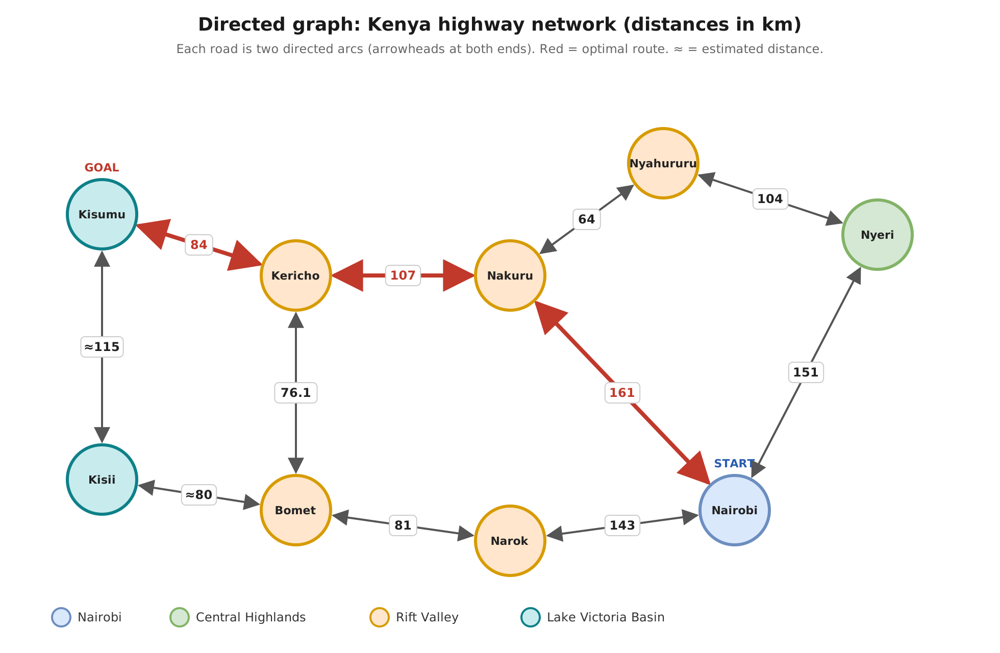
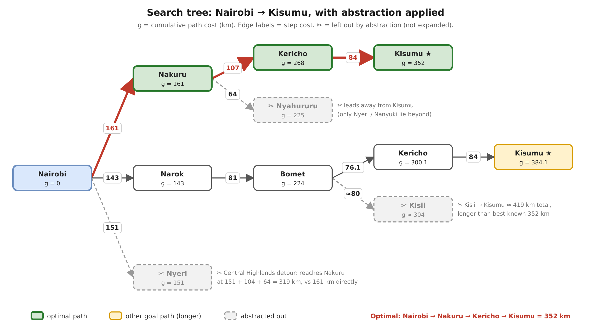

# Abraham Kilwake-190400, Natalie Shalo- 192640, Wachira Christine-176128

## Question 2: Kenya Highway Network: Directed Graph and Search Tree
### Nodes are states and arcs are actions. Every highway can be driven in both directions, so each road is represented by two directed arcs (A→B and B→A) with the same cost.

## Search Tree
### The root is the initial state and each branch is an action (a drive to the next town). g is the cumulative path cost. ✂ marks a branch that is left out by abstraction and not expanded. Going back to the town just left is also omitted, since it only creates loops

---

## Question 3: Determining the Optimal Path from Nairobi to Kisumu

### 3.1 Path Cost Function

The path cost is the total road distance travelled between towns, measured in kilometres (km).

**Path Cost Formula:**

g(n) = d1 + d2 + ... + dk

Where:
- g(n) represents the cumulative path cost.
- d represents the distance between consecutive towns.
- k represents the number of road segments.

### 3.2 Possible Routes and Distance Calculations

Four possible routes were identified from the directed graph.

#### Route 1: Nairobi → Nakuru → Kericho → Kisumu

| Road Segment | Distance (km) |
|---|---:|
| Nairobi → Nakuru | 161 |
| Nakuru → Kericho | 107 |
| Kericho → Kisumu | 84 |
| **Total** | **352** |

**Total Path Cost:**

161 + 107 + 84 = **352 km**

#### Route 2: Nairobi → Narok → Bomet → Kericho → Kisumu

| Road Segment | Distance (km) |
|---|---:|
| Nairobi → Narok | 143 |
| Narok → Bomet | 81 |
| Bomet → Kericho | 76.1 |
| Kericho → Kisumu | 84 |
| **Total** | **384.1** |

**Total Path Cost:**

143 + 81 + 76.1 + 84 = **384.1 km**

#### Route 3: Nairobi → Narok → Bomet → Kisii → Kisumu

| Road Segment | Distance (km) |
|---|---:|
| Nairobi → Narok | 143 |
| Narok → Bomet | 81 |
| Bomet → Kisii | ≈80 |
| Kisii → Kisumu | ≈115 |
| **Total** | **≈419** |

**Total Path Cost:**

143 + 81 + 80 + 115 ≈ **419 km**

#### Route 4: Nairobi → Nyeri → Nyahururu → Nakuru → Kericho → Kisumu

| Road Segment | Distance (km) |
|---|---:|
| Nairobi → Nyeri | 151 |
| Nyeri → Nyahururu | 104 |
| Nyahururu → Nakuru | 64 |
| Nakuru → Kericho | 107 |
| Kericho → Kisumu | 84 |
| **Total** | **510** |

**Total Path Cost:**

151 + 104 + 64 + 107 + 84 = **510 km**

### 3.3 Comparison of Routes

| Route | Total Distance (km) |
|---|---:|
| Nairobi → Nakuru → Kericho → Kisumu | **352** |
| Nairobi → Narok → Bomet → Kericho → Kisumu | 384.1 |
| Nairobi → Narok → Bomet → Kisii → Kisumu | ≈419 |
| Nairobi → Nyeri → Nyahururu → Nakuru → Kericho → Kisumu | 510 |

### 3.4 Optimal Path Selection

The optimal route is:

**Nairobi → Nakuru → Kericho → Kisumu**

**Minimum Path Cost = 352 km**

This route has the lowest cumulative distance among the possible routes represented in the graph.

Using Uniform Cost Search, the agent prioritises the path with the lowest cumulative cost.

